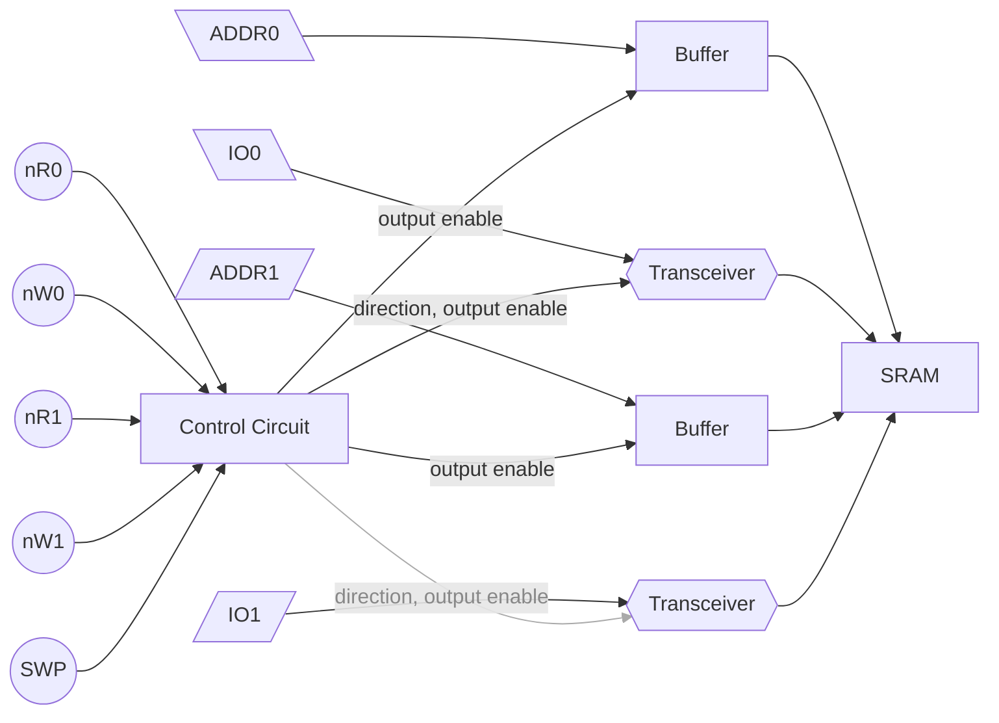

# Double Buffer
The double buffer is one of the most complicated PCBs in the project. It is a RAM module that serves the important function of facilitating data transfer between the CPU and GPU.

The PCB has two access ports, each consisting of an address and I/O port and 2 control signals to interface with the single RAM chip. The SWP signal determines which port gets to access the memory. 

In the final setup, 2 of these double buffer boards are stacked on top of each other such that they share all inputs and outputs except the SWP signal. The two boards get opposite SWP lines, allowing both ports to access their designated RAM chip. If the SWP line inverts, the physical chip the ports access is exchanged. Both ports can access data written by the other. 

In deployment, one port connects to the AOS CPU while the other connects to the GPU. The CPU writes frame-buffer data and then flips the SWP using a special `swp` instruction, effectively acting as a hardware double-buffer for the video data.

 