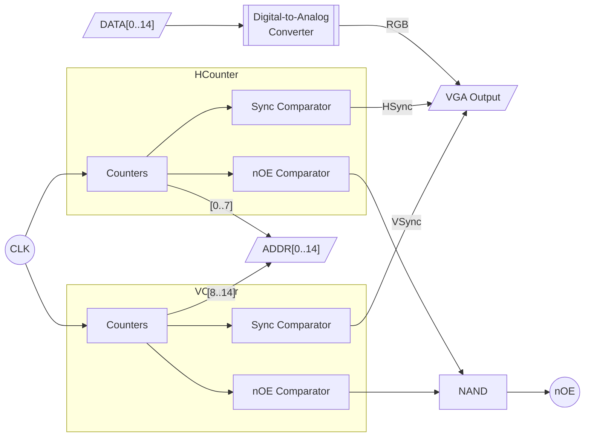

# AOS16 GPU


<h6 align="center">
GPU Front
</h6>


<h6 align="center">
GPU Back
</h6>



## VGA Signal Generation
The board generates the SXGA 640x480@85Hz video mode. Each pixel is repeated 4 times across both axes for an effective resolution of 160x120. 

| Value                    | Frequency           |
| ------------------------ | ------------------- |
| Screen refresh rate      | 85 Hz               |
| Vertical refresh         | 43.269230769231 kHz |
| Pixel frequency          | 36.0 MHz            |
| **Clock frequency used** | **9.0 MHz**         |

It works by using counters for both the horizontal and vertical scanlines. The sync and output signals are set and unset at specific trigger counter values. 


### Horizontal Timing
2 [74hc161](../datasheets/sn74hc161.pdf)s are used to count the effective pixels. A quarter of the clock frequency (36/4 = 9 MHz) is used with the effective values to match the expected signal timings. Every line ending is used as the clock signal of the vertical counting circuit.

The 7 lower bits of the counter are used as ADDR\[0..7].

| Scanline Part         | Pixels | Effective Pixels | Time (µs) |
| --------------------- | ------ | ---------------- | --------- |
| Visible Area          | 640    | 120              | 17.777    |
| Front Porch           | 56     | 14               | 1.555     |
| Sync Pulse (inverted) | 56     | 14               | 1.555     |
| Back Porch            | 80     | 20               | 2.222     |
| Whole Line            | 832    | 208              | 23.111    |

### Vertical Timing
3 hc161s are used to count the actual lines. Bits \[2..8] are forwarded as the vertical address to ADDR\[8..14], effectively repeating each pixel 4 times.

| Frame Part   | Lines | Time (ms) |
| ------------ | ----- | --------- |
| Visible Area | 480   | 11.09333  |
| Front Porch  | 1     | 0.02311   |
| Sync Pulse   | 3     | 0.06933   |
| Back Porch   | 25    | 0.577     |
| Full Frame   | 509   | 11.76355  |
|              |       |           |
## Linear Framebuffer Mapping

| Dimension  | Value          |
| ---------- | -------------- |
| Width      | 160px          |
| Height     | 120px          |
| Pitch      | 256 words      |
| Depth      | 5 bits / color |
| Pixelwidth | 1 word         |
```c
uint16_t *pixel = 0x7FFF + y*pitch + x
```